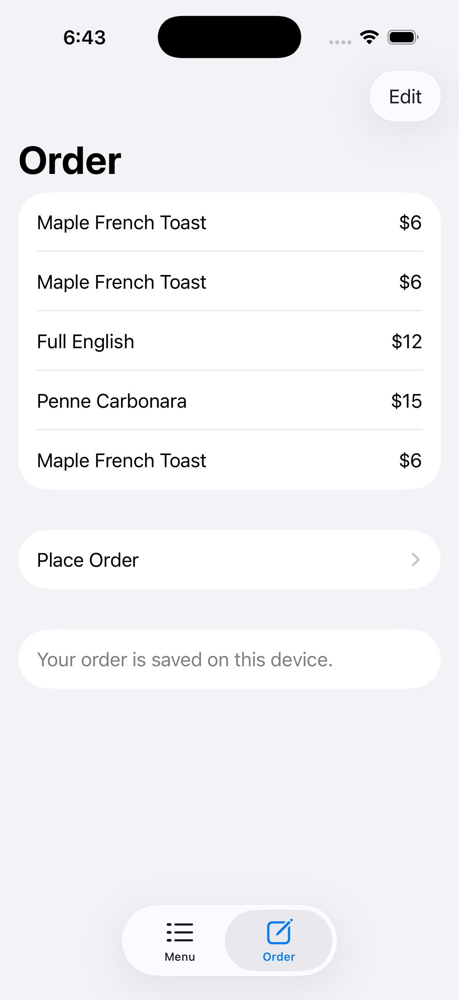

# Week06 — iDine: an order that survives closing the app

[Assignment: Local Data 2, More SwiftUI](https://github.com/molab-itp/content-2026-ima/blob/main/weeks/06_data.md#homework-week06)

The class iDine app now saves its order as JSON on the device. Add food, stop the app, and reopen it: the items and total return. Removing items also updates the saved order, including when the last item is removed. The Router class example is included as navigation practice.

## Run and try it

1. Open `iDine/iDine.xcodeproj` in Xcode.
2. Select the iDine scheme and an iPhone simulator, then run with **⌘R**.
3. Select a menu item, tap **Order This**, and check the **Order** tab.
4. Stop the app in Xcode and run it again. Return to Order; the food should still be there.
5. Delete an item using Edit, restart, and check that it stays deleted. Repeat with the last item.

| Before stopping the app | After launching it again |
| --- | --- |
|  |  |

## What changed

- `Order.swift`: the `items` array has a `didSet` observer that saves every change, including direct edits from the Order screen. `JSONEncoder` writes the `[MenuItem]` array to `order.json` in the app's Documents directory with an atomic write. `init()` decodes that file when a new order is created.
- A missing file is normal on first launch. A damaged file leaves the app usable with an empty order and a visible message; loading does not overwrite the damaged file. A failed write also shows a message.
- `OrderView.swift`: shows the storage status and uses a separate row position for each item, so adding the same food twice does not reuse one SwiftUI row identity.
- `MenuItem` was already `Codable` in the starter. The existing menu and order flows are retained.

## Swift fundamentals connected to this example

- `@State` in `iDineApp` owns the shared `Order`. `.environment(order)` passes it to the views, which read it using `@Environment(Order.self)`.
- `@Observable` lets SwiftUI track model changes. Keeping an object alive in memory does not persist it after the app exits; the file supplies that persistence.
- `didSet` responds to changes in `items`. Assigning its initial value inside `init()` does not invoke the observer, so loading does not immediately save over the file.
- `Codable` supports encoding and decoding the whole menu-item list. A computed `total` is derived from the restored items rather than saved separately.
- `do` / `try` / `catch` handles a missing, unreadable, or invalid file. `.atomic` protects against replacing the old file with a partly written one.

## Progress / problems / plans / questions

**Progress:** the Week06 folder contains both class examples, and iDine has automatic JSON saving and startup loading. The verification steps and automated model checks are included below.

**Problems addressed:** the original order existed only in memory; deleting from the list changed the array directly; the same food could appear more than once with the same menu-item ID. Saving is attached to the array, and the list gives each occurrence its own row position.

**Plans:** review this save/load flow and apply it to a small workout log for HabitaBull. Continue Swift fundamentals practice.

**Questions:** when should saving move off the main thread? For a growing workout history, when is a JSON file a better fit than SwiftData? How should a user recover an unreadable saved file?

## Automated checks

From the repository root on a Mac with Xcode installed:

```sh
zsh Week06/checks/run-persistence-checks.sh
```

The checks compile the actual `Order` and `MenuItem` models and use a temporary home directory. They cover first launch, restoring items and totals, duplicates, both deletion paths, saving an empty order, and preserving a damaged file. They do not use the user's Documents directory or simulator data.

Verification on October 15, 2026: all eight model checks passed, and the iPhone simulator build passed with Xcode 26.6. In the iOS 26.5 simulator, five items totaling $45 survived stopping and relaunching the app; the screenshots above show that result. Deleting the last sample item saved a four-item order totaling $39.

## Sources and assistance

The menu, photos, and original restaurant app come from the class's [06-iDine](https://github.com/molab-itp/06-iDine), based on [Paul Hudson's iDine](https://github.com/twostraws/iDine). Router comes from [06-Router](https://github.com/molab-itp/06-Router). Original source credits are retained.

OpenAI Codex (ChatGPT), October 15, 2026, implemented the JSON persistence extension, storage-status display, repeated-item row fix, automated checks, and this documentation, and assisted with verification and the wiki update. This is AI-assisted work based on the class examples.

## Class examples included

### iDine

the iDine restaurant app, cloned from [molab-itp/06-iDine](https://github.com/molab-itp/06-iDine). it's the [Hacking with Swift SwiftUI tutorial](https://www.hackingwithswift.com/quick-start/swiftui/swiftui-tutorial-building-a-complete-project) ([twostraws/iDine](https://github.com/twostraws/iDine)), updated in class to use `@Observable` instead of `ObservableObject`

open `iDine/iDine.xcodeproj` in Xcode

- **Model:** `MenuSection` (the menu, loaded from `menu.json` with `Bundle-decode.swift`) + `Order` (the shared order)
- **Views:** `ContentView` (menu list), `ItemRow`, `ItemDetail`, `OrderView`, `CheckoutView`
- `MainView` holds the tabs: menu + order

### Router

cloned from [molab-itp/06-Router](https://github.com/molab-itp/06-Router). switching pages without `NavigationView`: a `PageModel` (`@Observable` class) remembers which page you're on, and buttons at the bottom change it. based on [03-ImageUiDemo-2-urls](https://github.com/molab-itp/03-ImageUiDemo-2-urls)

open `Router/Router.xcodeproj` in Xcode

- `RouterApp` makes one `PageModel` and hands it down with `.environment`
- `MainView` reads it with `@Environment`, a `switch` on `pageTag` shows Page1, Page3 or Page5, and the `[Page1] [Page3] [Page5]` buttons set it (the one you're on is bold)
- Page1: image from a URL · Page2: `Item` struct · Page3: `List` · Page4: `ItemRow` + `ItemDetail` · Page5: local image + `Toggle`, `Slider`, `Picker`
