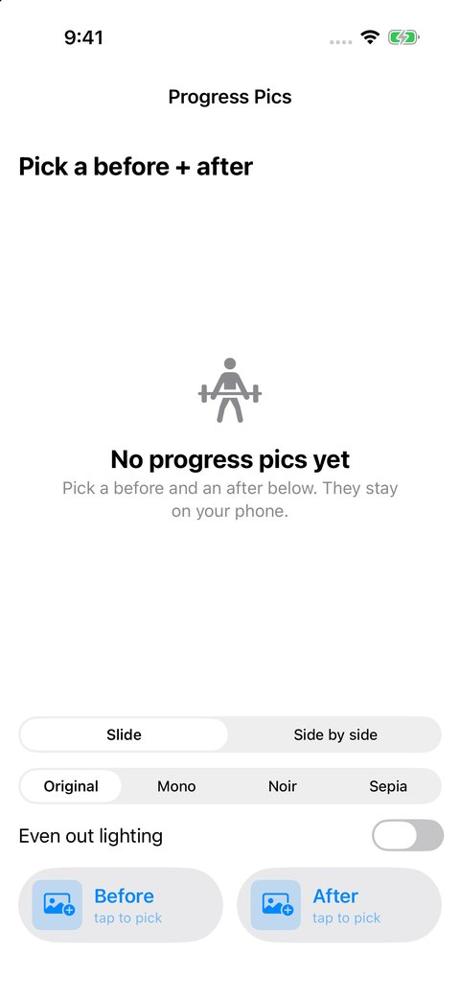
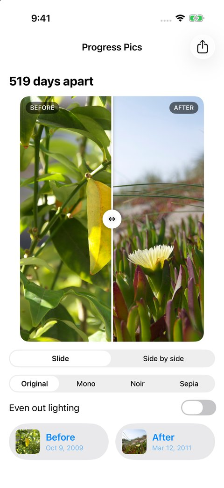
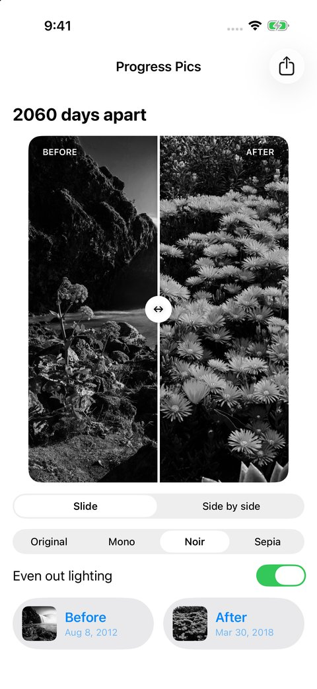
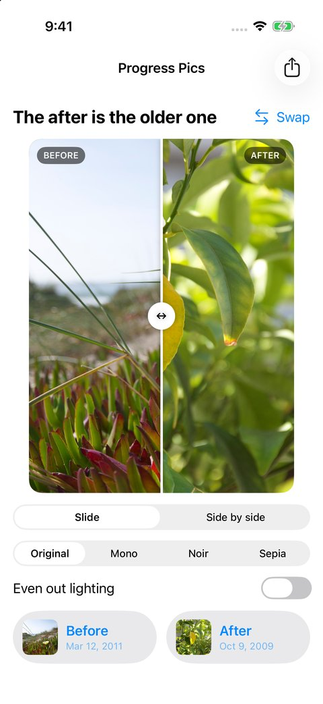
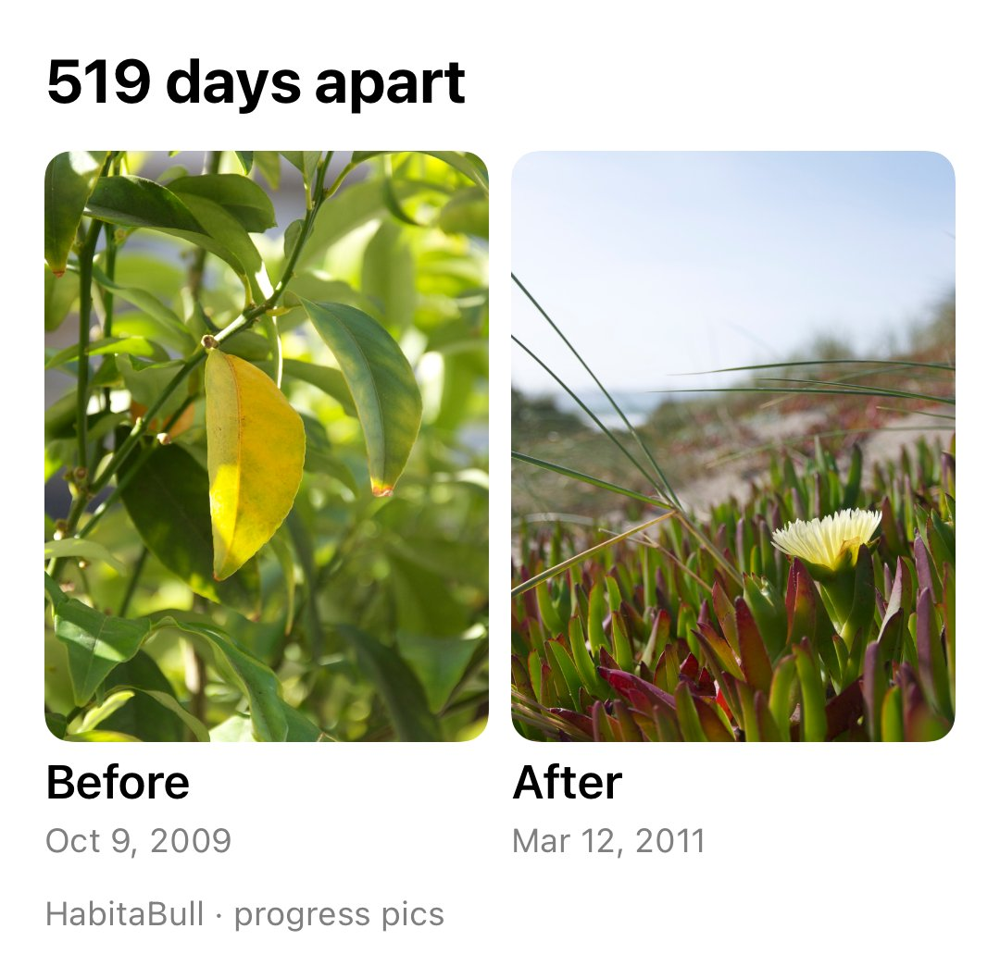

# Week07: Progress Pics

[Assignment: Photo Media](https://github.com/molab-itp/content-2026-ima/blob/main/weeks/07_photo.md#homework-week07)

a before/after progress-photo app, and a test run of a progress-pic feature for HabitaBull (my final). it's built on the class [07-Instafilter](https://github.com/molab-itp/07-Instafilter) (PhotosPicker + Core Image + ShareLink). my twist: it uses **two** photos instead of one. you pick a before and an after, the app reads when each was taken and says how many days apart they are, puts the same filter on both, and you drag a line across to compare. the share button makes a side-by-side card

| empty | slide to compare | noir + even out lighting | after picked first | share card |
| --- | --- | --- | --- | --- |
|  |  |  |  |  |

the screenshots use the sample photos that come with the iOS simulator (plants, waterfalls), not real progress pics

## run it

1. open `ProgressPics/ProgressPics.xcodeproj` in Xcode (iOS 18+)
2. pick an iPhone simulator or your phone, **⌘R**
3. tap **Before** and pick a photo, then **After**
4. drag on the photo to move the line. try the looks, **Even out lighting**, and **Side by side**
5. share button (top right) → Save Image or send the card

on your own phone the signing team is already set to mine. if Xcode complains, pick your team under Signing & Capabilities

## what it does

- **two photo slots.** each one is a `PhotosPicker`. the picker runs outside the app, so the app never asks for your whole library. only the 2 photos you pick reach it, and nothing leaves the phone unless you share the card. that matters for progress pics
- **days apart.** reads `DateTimeOriginal` from each photo's EXIF data, which is when the shutter went, not when it was edited or downloaded. counts calendar days (11pm → 7am next day = 1 day). no date in a photo → it says so, it doesn't guess. after older than before → a **Swap** button shows up
- **same look on both:** Original, Mono, Noir, Sepia. same filter, so the only difference left is you
- **even out lighting:** runs Core Image's auto-enhance (`autoAdjustmentFilters`) on each photo first, so a dark basement-gym pic and a bright mirror pic end up closer. it fixes each photo on its own, it doesn't copy one photo's lighting onto the other
- **slide or side by side.** the slider is drag-anywhere, and a tap jumps the line there. VoiceOver can move it too (swipe up/down)
- **share card:** a 1080px-wide image of both photos with their dates, made with `ImageRenderer` and sent with `ShareLink`. it's always light so it looks the same in dark mode

## how it's built

| file | what's in it |
| --- | --- |
| `ProgressPicsApp.swift` | makes the one `Comparison` and passes it down with `.environment` |
| `Comparison.swift` | `@Observable` class: both photos, the look, the toggle, the processed images + card. `didSet` re-develops when anything changes |
| `PhotoProcessing.swift` | opening a photo (upright + shrunk to 1600px), reading the EXIF date, `daysBetween`, the looks, `Darkroom.develop`. no UIKit/SwiftUI, so the checks can test it on the Mac |
| `ContentView.swift` | the screen + `PhotoSlot` (the picker buttons) |
| `CompareSlider.swift` | the drag-to-compare view + `FilledPhoto` |
| `ShareCard.swift` | the card the share button sends |
| `ScreenshotHook.swift` | debug builds only: loads photos from files so the README screenshots didn't need tapping through the picker |

### new swift stuff this week

- `PhotosPicker` + `loadTransferable(type: Data.self)` (from Instafilter), and `CGImageSource` from ImageIO to open that data. one source gives you a shrunk upright image **and** the photo's metadata (EXIF date, orientation)
- photos from a phone are often stored sideways with an orientation tag. `kCGImageSourceCreateThumbnailWithTransform` turns them upright. without it a portrait pic comes in rotated
- Core Image: a `CIFilter` takes a `CIImage` and gives back a new one. nothing is actually drawn until `CIContext.createCGImage`. one shared `CIContext`, because making one is slow (same as Instafilter)
- `ImageRenderer` turns any SwiftUI view into a `UIImage`. that's how the share card is made
- `Task.detached` so opening a 12 MP photo doesn't freeze the screen, then back to the main actor to update the model
- `@State` inside `CompareSlider` instead of in `ContentView`, so dragging only redraws the slider and not the whole screen
- `ReferenceWritableKeyPath` (`\.before` / `\.after`) so one `load` function fills either slot

## part 1: midterm checklist

it's at the top of the [repo README](../README.md#midterm-checklist). i checked off what i could confirm (wiki page, jht9629-nyu is a collaborator, Xcode 27.1 installed). the rest is still open

## part 3: final project research

HabitaBull is my final. the native iOS version of [my web app](https://habitabull.vercel.app), and i'm planning to put it on the App Store. notes on what only the phone can do, each tied to a WWDC video or Apple sample: [final-research.md](final-research.md)

## progress / problems / plans / questions

**progress**
- Week07 app: two-photo progress compare with EXIF dates, 4 looks, auto lighting fix, slide + side-by-side, share card
- 20 automated checks on the photo code (below), builds with no warnings for the simulator and for iPhone
- final project research for HabitaBull: 7 phone-only ideas, 16 WWDC sessions + Apple samples, all links checked

**problems**
- the iOS simulator's sample photos had two different dates in them. the EXIF "original" date and the TIFF date (last edited) were months apart, and `sips` showed the TIFF one. the app uses `DateTimeOriginal`, the TIFF date is only a fallback
- the before photo has to sit on top of the after and get cut off at the line. a `mask` with a rectangle `width * split` wide does it. both photos need the exact same frame or they don't line up
- the first screenshots came out blank because the simulator was still developing both photos. on the Mac it takes ~50–300ms per photo. moved opening photos off the main thread

**plans**
- put this into HabitaBull as a "progress" tab, and save the photo pairs on the phone
- a camera mode with the last progress pic as a see-through ghost, so you stand in the same spot every time
- Live Activity rest timer is next for HabitaBull (see research)

**questions**
- for a progress-pic feature, is it better to keep the photos in the app's own storage instead of in Photos (more private) or leave them in Photos?
- is EXIF `DateTimeOriginal` reliable for photos that come through AirDrop / iCloud, or do some apps strip it?
- for the App Store: anything we should know about TestFlight before the final presentation?

## automated checks

from the repo root on a Mac with Xcode:

```sh
zsh Week07/checks/run-photo-checks.sh
```

compiles the app's real `PhotoProcessing.swift` on the Mac and runs it against JPEGs made in memory. 20 checks: the EXIF date is read (and a photo with no date gives nil, not today), non-image data is refused, a sideways photo comes out upright, big photos shrink to 1600px with the same shape, days apart (11pm→7am, same day, Aug 31→Oct 17 = 47, the Nov 1 clock change, negative when swapped), each look keeps the size, Original changes nothing, Mono/Noir turn red gray, Sepia turns it brown, and even out lighting brightens a dark photo

**verified Oct 22, 2026:** all 20 checks pass. breaking the code on purpose (turning off the upright fix, the start-of-day math, the lighting fix, or reading the wrong date field) makes a check fail each time. builds with no warnings for the iPhone 17 simulator and for a generic iOS device (Xcode 27.1). in the simulator: a JPEG pair from Oct 9 2009 and Mar 12 2011 shows "519 days apart", a JPEG + HEIC pair from Aug 8 2012 and Mar 30 2018 shows "2060 days apart" in Noir with even out lighting, picking the newer photo as before shows Swap, and the share card comes out 1080px wide (all screenshots above). those screenshots loaded photos with the debug hook, so the photo picker itself wasn't tapped through in this run. it's the same picker code as Instafilter

## sources + AI assistance

- based on [molab-itp/07-Instafilter](https://github.com/molab-itp/07-Instafilter) ([Paul Hudson's Instafilter, Hacking with Swift project 13](https://www.hackingwithswift.com/books/ios-swiftui/instafilter-introduction)): PhotosPicker, `loadTransferable`, CIFilter + CIContext, ShareLink
- [Bringing Photos picker to your SwiftUI app](https://developer.apple.com/documentation/photokit/bringing-photos-picker-to-your-swiftui-app), [CoreImageFilterReference](https://developer.apple.com/library/archive/documentation/GraphicsImaging/Reference/CoreImageFilterReference/index.html), Apple's ImageIO / `CGImageSource` docs
- the Xcode project setup is copied from my HabitaBull project
- Claude (Anthropic), October 22, 2026, wrote the app code, the checks and this README, and made the simulator screenshots, building on the class demo and my HabitaBull plans. this is AI-assisted work
