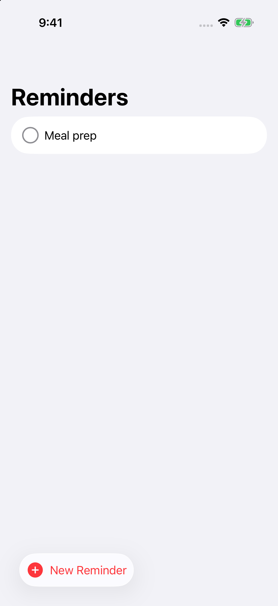
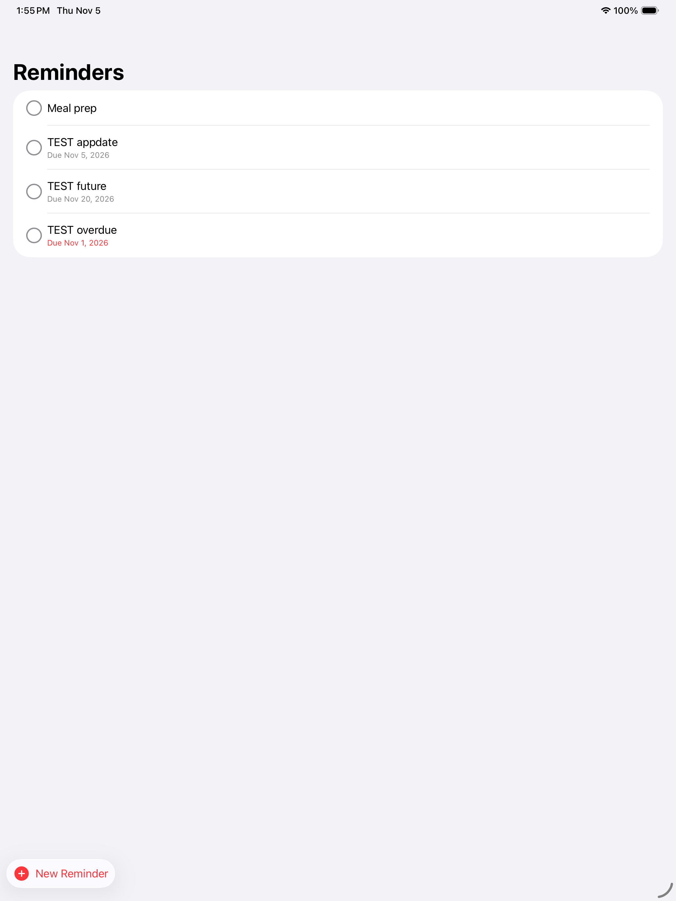
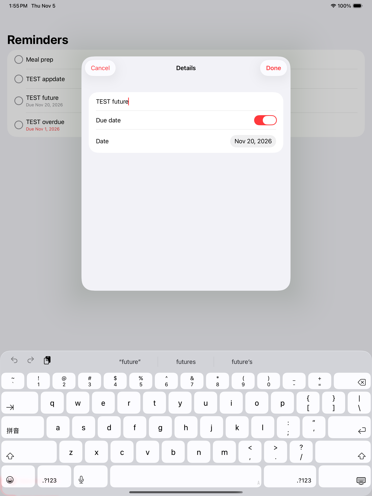

# Week09: MakeItSo

[Assignment: Multi User Experience 1](https://github.com/molab-itp/content-2026-ima/blob/main/weeks/09_multi.md#homework-week09) · [final project proposal, first draft](https://github.com/molab-itp/content-2026-ima/wiki/05%E2%80%90Lucy#week-09-makeitso--final-proposal-draft)

Option 1: a to-do list that saves to the cloud. it's the class [09-MakeItSo](https://github.com/molab-itp/09-MakeItSo) (from [Peter Friese's tutorial](https://peterfriese.github.io/MakeItSo/tutorials/makeitso/)) running on my own Firebase project with Cloud Firestore

my addition: **due dates**. turn on Due date on a reminder, pick a day, and it shows under the title. it turns red once it's late, unless the reminder is done

 

(the TEST reminders were test data, deleted after)

## what I changed

the class repo already has the finished app, so this week was the Firebase setup, plus one feature.

setup:

- team + bundle ID in Xcode → `com.wl3512.MakeItSo`
- new Firebase project, with an iOS app registered to that bundle ID
- swapped in my own `GoogleService-Info.plist` so the app stopped pointing at the class project
- made a Firestore database in test mode

due date:

| file | what changed |
| --- | --- |
| `Reminder.swift` | `dueDate: Date?`, optional so older reminders with no date still load. `isOverdue` is true from the day after the due date, and never if it's done |
| `EditReminderDetailsView.swift` | Due date toggle + date-only `DatePicker`, with custom `Binding`s because the picker needs a `Date` and the model holds a `Date?` |
| `RemindersListRowView.swift` | shows "Due Nov 20, 2026" under the title, grey or red |
| `RemindersRepository.swift` | removed `merge: true` from `setData`. a nil date isn't in the encoded data, so merging would keep the old date |

## run it

1. make a Firebase project, add an iOS app with your bundle ID, turn on Firestore
2. put your `GoogleService-Info.plist` in `MakeItSo/MakeItSo/`. it isn't in this repo on purpose, because a test-mode database is open to anyone who has the project details
3. open `MakeItSo/MakeItSo.xcodeproj`, wait for the Firebase packages, ⌘R

## how it saves

- `RemindersRepository.swift` does all the Firestore work. the views never touch Firebase
- `addSnapshotListener` keeps a live connection to the `reminders` collection. any change reruns the closure, the documents get turned into `Reminder` structs, and `@Published` redraws the list
- `Reminder` is `Codable`, same idea as the week 06 JSON saving, except it goes to `addDocument(from:)` and not a file
- `@DocumentID` fills in the id Firestore picks, and update + delete use it to find the right document
- no sign-in, so everyone using this database shares one list. that's the multi-user part

## checks

- ran on the iPhone 17 simulator (Nov 5). added "Meal prep", it showed up in the list
- read the `reminders` collection back from Firestore's REST API: one document, `title: "Meal prep"`, `isCompleted: false`, created 2026-11-05 18:38 UTC. so it really reached the cloud
- due dates, on the real database with a throwaway test build: added one from the app (saved as a Firestore timestamp), loaded it back, cleared it (field gone), and Meal prep with no date still loaded. grey + red both show up right, and the details sheet opens with the saved date
- not tested by hand: tapping the toggle and picking a date, deleting, or two devices at once
- launched on the iPad Pro 13-inch (M5) simulator too. Xcode showed "Could not attach to pid" with a code signature message, but the log shows the app got a normal stop signal (SIGTERM) and didn't crash. signing was fine

## sources / AI assistance

- based on [molab-itp/09-MakeItSo](https://github.com/molab-itp/09-MakeItSo) and [peterfriese/MakeItSo](https://peterfriese.github.io/MakeItSo/tutorials/makeitso/)
- I used Claude (Anthropic), November 5, 2026, to set up Firebase, and update my wiki. AI-assisted work
